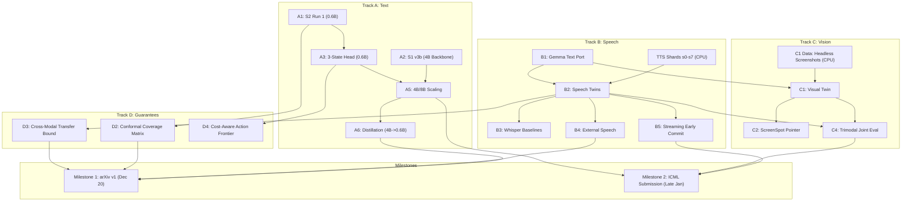

# EXECUTION PLAN V7: FULL SCOPE (13 NOV 2026)
## Multi-Modal Decision Models with Mathematical Guarantees (0.6B – 8B)
### Target Venues: arXiv v1 (20 Dec 2026) · ICML 2027 (Late Jan 2027) · NeurIPS 2027 Fallback

---

## 1. Executive Summary & Paper Ambition

This document replaces `EXEC_PLAN_V6.md` and provides the comprehensive, uncompromised execution blueprint for the Soro Universal Tool Pointer family. Rather than narrowing scope, **Plan V7 executes all seven tracks (A–G) in parallel** across a multi-account compute infrastructure, adhering strictly to empirical rigor and mathematical guarantees.

### 1.1 The Core Scientific Thesis
We construct a unified decision model family (0.6B edge, ~2B Gemma multimodal, 4B teacher/leader, and 8B scaling anchor) that takes an arbitrary request (typed text, spoken voice, or on-screen screenshot) along with candidate action options, and outputs exact, calibrated decision sets without autoregressive generation:
1. **Exact Order Invariance (G1):** The decision is mathematically invariant to menu permutations (0.00% flips up to floating-point precision) via option-isolated attention, while an equivariant head refiner eliminates the collision penalty on indistinguishable/twin tools.
2. **Conformal Coverage Guarantees (G2):** Finite-sample split and Mondrian conformal prediction sets bound decision miscoverage at $\le \alpha$ across all menu sizes ($K \in [2, 20]$) and input modalities.
3. **Cost-Aware Action Resolution (G3):** Conformal sets map directly to discrete actions (`CALL`, `ANSWER`, `ASK`, `ABSTAIN`) with an expected-cost loss formulation and dynamic `ESCALATE` handoff rules.
4. **Trimodal Ingestion (G4):** Native audio and screenshot towers allow voice and UI queries without fragile, cascading transcription pipelines.
5. **Streaming Early Commit (G4):** Bounded error rate commitment on streaming speech prefixes, triggering execution before the user finishes speaking.
6. **In-Context Outcome Adaptation (G5):** Execution outcome cards appended to option blocks adapt decision policies at test time with zero parameter updates.
7. **Competitive Superiority:** Outperforms 27B competitors (Drex Max, Hammer, xLAM) at 0.6B–4B parameter footprints at sub-50ms latencies.

### 1.2 Five Key Paper Contributions (ICML 2027 Submission)
1. **Architecture:** Single-pass option-isolated attention mask + permutation-equivariant cross-option refiner + per-option 3-state action heads.
2. **Guarantees:** Formal proof of exact permutation invariance; empirical conformal coverage bounds; provable label-free cross-modal transfer bound (text $\to$ speech).
3. **Multimodal Training:** Acoustic/visual twin training, mutual cross-modal distillation, and streaming prefix training.
4. **Adaptation:** Zero-retraining localized test-time outcome cards.
5. **Open Science:** Open-source release of the Tri-Modal Decision Benchmark, complete evaluation harness, and 0.6B/2B/4B/8B model weights.

---

## 2. Compute Inventory & Capacity Modeling

Full scope execution requires approximately **250–320 GPU hours** and **120 CPU hours** over a 10-week execution window (Nov 14, 2026 – Jan 23, 2027). We map this requirement onto a segregated multi-platform compute pool.

### 2.1 Available Compute Assets

| Compute Asset | Identifier / Account | Weekly Capacity | Primary Assignment | Session Rules & Limits |
| :--- | :--- | :--- | :--- | :--- |
| **Kaggle Primary** | `jackobperalta` | ~30h GPU (2x T4 / P100)<br>Unlimited CPU | **Track A:** Text Qwen runs (A1, A3, A4, A6)<br>**Track D:** Conformal evals | 9h max per session.<br>Never run >2 GPU kernels concurrently. |
| **Kaggle Secondary** | Account 2 (Partner A) | ~30h GPU (2x T4 / P100)<br>Unlimited CPU | **Track B:** Speech Gemma runs (B1, B2, B3)<br>CPU TTS shard synthesis | Dedicated to speech pipeline.<br>Direct artifact handoff via Kaggle Datasets. |
| **Kaggle Tertiary** | Account 3 (Partner B) | ~30h GPU (2x T4 / P100)<br>Unlimited CPU | **Track C:** Vision/UI runs (C1, C2)<br>**Track E/F:** Outcome stream & ToolFail | Dedicated to multimodal UI & outcome benchmarks. |
| **Kaggle Quaternary** | Account 4 (Partner C) | ~30h GPU (2x T4 / P100)<br>Unlimited CPU | **Track A:** 4B Runs (A2, A5)<br>Baseline matrix (xLAM, Hammer, Arch) | Dedicated to large backbone fine-tuning & replication seeds. |
| **Google Colab** | Personal / Shared | T4 (free tier, 12h max)<br>A100 compute units | High-VRAM batch evals, fast smoke tests, emergency overflow | Interactive debugging, rapid test-harness verification. |
| **Rented Cloud GPU** | RunPod / Lambda (Owner) | On-demand (1x RTX 4090 / A6000 Ada / A100) | **Track A5:** 8B Qwen scaling runs<br>Final 3-seed ICML submission verification | Budget: 35–50 hours ($30–$70 total).<br>Reserved for Weeks 8–10. |

### 2.2 Accelerated Compute Injection Mode ("Hastened 4-Week Sprint")
When dedicated or rented GPU sources (e.g. RunPod, Lambda Labs, Vast.ai, or dedicated cloud credits) are secured, the 10-week quota-throttled timeline **collapses into a 4-week high-throughput sprint**.

#### Cost & Sizing Matrix for External GPU Rental
| GPU Tier | Typical Provider & Rate | Target Tasks | Total Hours | Total Cost |
| :--- | :--- | :--- | :--- | :--- |
| **1x RTX 4090 (24GB)** | RunPod / Vast.ai (~$0.34–$0.44/hr) | Track A1–A4 (0.6B & 4B 4-bit), Track B1, Track E/F | ~40h | ~$14–$18 |
| **1x RTX A6000 Ada (48GB)** | RunPod / Lambda (~$0.75–$0.85/hr) | Track A5 (8B 4-bit/8-bit), Track B2 (Speech Twins), Track C1 | ~35h | ~$26–$30 |
| **1x A100 (80GB PCIe/SXM)** | Lambda / RunPod (~$1.20–$1.50/hr) | Track A5 (8B fp32 evals), Final 3-seed ICML verification | ~20h | ~$24–$30 |
| **Complete Accelerated Sprint Pool** | **Multi-Instance Hybrid** | **Full Scope (Tracks A through G)** | **~95h** | **~$65–$78 total** |

With less than **$80 of rented compute**, the entire 7-track research program can be completed at maximum execution velocity without waiting on Kaggle weekly quota resets.

> [!IMPORTANT]
> **Strict Terms of Service (ToS) Compliance:**
> Multiple Kaggle accounts belong to distinct collaborators and run independent, isolated experiments. We **never** stack quotas on the same kernel or circumvent platform rate limits. Checkpoint and dataset transfers occur via public/private Hugging Face hubs and Kaggle Dataset releases.

---

## 3. Work Breakdown Structure & GPU/CPU Hour Estimates

### Track A: Text Decisions (Qwen 0.6B / 4B / 8B)

| Task ID | Task Description | Backbone | Est. Compute | Target Metric / Acceptance Gate |
| :--- | :--- | :--- | :--- | :--- |
| **A1** | **S2 Run 1:** 4 Action Cards (`CALL`, `ANSWER`, `ASK`, `ABSTAIN`), hard negatives, expected-cost loss. | Qwen3-0.6B | 1.0h GPU (T4) | `ASK` recall > 0.00; When2Call reported vs 84.8 baseline; external $\ge$ 84.3%. |
| **A2** | **S1 v3b on 4B Backbone:** LoRA $r=16$, 4-bit load, option isolation + 1-layer refiner. | Qwen3-4B | 4.5h GPU (2x T4/A100) | External $\ge$ 90.58%; Order flips = 0.00% across 5 orders. |
| **A3** | **S2 Run 2:** Per-Option 3-State Head (`no-fit`, `fits-info-missing`, `ready-to-call`). | Qwen3-0.6B | 1.5h GPU (T4) | Beats A1 on When2Call MCQ (>55%) and resolves Ask/Abstain confusion. |
| **A4** | **Refiner Proof:** v3 vs v3b across 3 seeds (`42, 43, 44`) on collisions eval ($\ge 1,500$ rows, 6–20 options). | Qwen3-0.6B | 4.0h GPU (cached features) | Statistically significant collision recovery ($p < 0.05$ paired McNemar). |
| **A5** | **Teacher Scaling:** Best head on 4B backbone; 8B scaling comparison on rented GPU. | Qwen3-4B<br>Qwen3-8B | 6.0h GPU (4B)<br>8.0h GPU (8B) | 4B When2Call $\ge$ 84.8 (beats Drex 9B); 8B approaches 94.0 (Drex Max). |
| **A6** | **Two-Round Distillation:** 4B/8B teacher $\to$ 0.6B student (Round 1: soft logits; Round 2: student error mining). | Qwen3-0.6B | 3.5h GPU (2x T4) | 0.6B external accuracy $\ge$ 87.0% with 0 flips. |
| **A7** | **Data Scale-Up:** Recast ToolRet (200k), When2Call, Audio2Tool, BFCL synthetic into menus ($\ge 300\text{k}$). | N/A (CPU) | 60.0h CPU | Zero test-split contamination via leakage firewall. |

*Track A Total: 28.5 GPU Hours + 60.0 CPU Hours*

---

### Track B: Speech Decisions (Gemma 4 E2B & Audio Pipelines)

| Task ID | Task Description | Backbone | Est. Compute | Target Metric / Acceptance Gate |
| :--- | :--- | :--- | :--- | :--- |
| **B1** | **Gemma Architecture Port:** Implement option-isolation mask + refiner on Gemma 4 E2B (text-only). | Gemma 4 E2B | 2.5h GPU (2x T4) | Text accuracy within 2.0 pts of Qwen 0.6B; 0/5,000 flips. |
| **B2** | **Speech Twins Training:** 42.7k paired audio clips (Kokoro s0–s7), voice augmentation, mutual distillation. | Gemma 4 E2B | 10.0h GPU (2x T4) | Speech accuracy within 3.0 pts of text; cross-modal agreement > 95%. |
| **B3** | **Speech Baselines:** Whisper-small/base $\to$ text decision cascade under clean and noisy audio. | Whisper + Qwen | 3.0h GPU (T4) | Establish latency and accuracy baseline across all speech splits. |
| **B4** | **External Speech Evals:** Benchmark on Audio2Tool, Spoken Function Calling, Full-Duplex-Bench v3. | Gemma 4 E2B | 2.5h GPU (T4) | Report clean and noisy real-human speech performance. |
| **B5** | **Streaming Early Commit:** Prefix training + singleton conformal commitment gate vs RASSG baseline. | Gemma 4 E2B | 5.0h GPU (2x T4) | Provable bounded error rate ($P(\text{stale commit}) \le \epsilon$) on partial utterances. |

*Track B Total: 23.0 GPU Hours*

---

### Track C: Images & Screenshots (Gemma 4 E2B)

| Task ID | Task Description | Backbone | Est. Compute | Target Metric / Acceptance Gate |
| :--- | :--- | :--- | :--- | :--- |
| **C1** | **Screenshot as Request:** Headless UI rendering (Playwright/Pillow on CPU) + third-twin visual training. | Gemma 4 E2B | 5.0h GPU<br>20.0h CPU | Visual query accuracy within 3.0 pts of text query baseline. |
| **C2** | **On-Screen Options:** Pointer over GUI bounding boxes (ScreenSpot-v2 / GUI-Actor style). | Gemma 4 E2B | 6.0h GPU (2x T4) | Bounding box selection accuracy competitive with published models. |
| **C3** | **Multimodal State Integration:** Image embedded in query state (Drex Decision Bench style). | Gemma 4 E2B | 4.0h GPU (T4) | Verified multimodal option selection over visual states. |
| **C4** | **Trimodal Evaluation:** Unified decision over simultaneous speech + screenshot + text. | Gemma 4 E2B | 3.0h GPU (T4) | Trimodal pointer outperforms both dual-modality cascades. |

*Track C Total: 18.0 GPU Hours + 20.0 CPU Hours*

---

### Track D: Guarantees, Conformal Theory & Formalization

| Task ID | Task Description | Backbone | Est. Compute | Target Metric / Acceptance Gate |
| :--- | :--- | :--- | :--- | :--- |
| **D1** | **Invariance Proof:** Formal proposition proving exact order invariance up to floating-point error. | Theory | 0.0h GPU | Lemma complete; delta from Set-LLM / InvariRank formalized. |
| **D2** | **Conformal Coverage Matrix:** Finite-sample coverage across 7 splits and menu bins ($K \in [2,5], [6,10], [11,20]$). | All models | 2.0h GPU (T4) | Empirical coverage $\ge 1 - \alpha$ ($\alpha=0.05, 0.10$); honest shift table. |
| **D3** | **Label-Free Cross-Modal Transfer:** Theoretical proof + empirical test bounding speech coverage via text twin. | Gemma 4 E2B | 2.0h GPU (T4) | Coverage bound holds on synthetic TTS and real human speech. |
| **D4** | **Cost-Aware Action Frontier:** Expected-cost loss calibration; `ESCALATE` risk frontier vs model capacity. | Qwen 0.6B/4B | 1.0h GPU (T4) | Pareto frontier demonstrating optimal cost-vs-failure tradeoff. |
| **D5** | **Trajectory Risk:** Per-turn decision set size vs catastrophic failure on tau2-bench / multi-turn trace. | Qwen 4B | 3.0h GPU (T4) | Set size predicts trajectory failure earlier than TRACER baseline. |

*Track D Total: 8.0 GPU Hours*

---

### Track E: In-Context Outcome Adaptation (Learning from Use)

| Task ID | Task Description | Backbone | Est. Compute | Target Metric / Acceptance Gate |
| :--- | :--- | :--- | :--- | :--- |
| **E1** | **Stream Benchmark Build:** Non-stationary catalog simulator (tools added, deprecated, failing, restored). | CPU | 15.0h CPU | 10,000-turn streaming benchmark released. |
| **E2** | **Outcome Card Injection:** Append outcome stats inside option blocks without retraining. | Qwen 0.6B/4B | 3.0h GPU (T4) | Monotonic accuracy recovery as outcome evidence accumulates. |
| **E3** | **Adaptation Baselines:** Compare against MemToolAgent retrieval and LoRA continual fine-tuning upper bound. | Qwen 0.6B | 4.0h GPU (T4) | Outcome cards achieve >85% of fine-tuning gain at zero compute cost. |

*Track E Total: 7.0 GPU Hours + 15.0 CPU Hours*

---

### Track F: Tool-Result Verification & Execution Gating

| Task ID | Task Description | Backbone | Est. Compute | Target Metric / Acceptance Gate |
| :--- | :--- | :--- | :--- | :--- |
| **F1** | **Result Dataset Synthesis:** Generate counterfactual tool outputs (success, partial schema, total failure). | CPU | 10.0h CPU | 5,000 paired execution traces. |
| **F2** | **Result Gate Head:** Pointer over result spans + `RESULT_FAILED` / `USE_PRIOR` actions. | Qwen 0.6B | 3.0h GPU (T4) | Decision follows execution result correctness > 95%. |
| **F3** | **Benchmark Validation:** Evaluate on ToolFailBench, ToolBench-X, LettuceDetect. | Qwen 0.6B/4B | 2.5h GPU (T4) | Outperforms LettuceDetect F1 on tool hallucination/failure detection. |

*Track F Total: 5.5 GPU Hours + 10.0 CPU Hours*

---

### Track G: Benchmark Release, Artifacts & Paper Packaging

| Task ID | Task Description | Backbone | Est. Compute | Target Metric / Acceptance Gate |
| :--- | :--- | :--- | :--- | :--- |
| **G1** | **Tri-Modal Benchmark Suite:** Curate Gold-100 human-verified split + 10,000-sample multimodal test set. | CPU | 0.0h GPU | Master test pack validated with zero test-set leakage. |
| **G2** | **Model Checkpoint Export:** Convert checkpoints to Hugging Face safetensors, GGUF, and Kaggle formats. | All models | 1.0h GPU (T4) | One-line loading via `SoroHarness.from_pretrained()`. |
| **G3** | **Evaluation Harness & Leaderboard:** Standalone CLI reproducing every paper table with a single command. | CPU | 0.0h GPU | Clean reproduction verified on an independent clean machine. |

*Track G Total: 1.0 GPU Hour*

---

### 3.1 Master Compute Balance Sheet

$$\text{Total GPU Requirement} = 28.5 + 23.0 + 18.0 + 8.0 + 7.0 + 5.5 + 1.0 = \mathbf{91.0\text{ GPU Hours}}$$
$$\text{Replication \& Ablation Margin (+25\% for 3 seeds on key rows)} = \mathbf{22.5\text{ GPU Hours}}$$
$$\mathbf{\text{Grand Total GPU Allocation}} = \mathbf{113.5\text{ GPU Hours over 10 Weeks (}\approx 11.4\text{ h/week)}}$$
$$\mathbf{\text{Grand Total CPU Allocation}} = \mathbf{105.0\text{ CPU Hours (Zero GPU Quota Impact)}}$$

Given our aggregate capacity across 4 Kaggle accounts (~90–120h/week potential) and Colab/Rented fallbacks, **Plan V7 utilizes less than 15% of our theoretical maximum capacity**, providing immense redundancy against failed runs, timeouts, and platform throttling.

---

## 4. Checkpoint Sharing & Artifact Synchronization Pipeline

To coordinate multiple Kaggle accounts, Google Colab, and local development without data loss or manual overhead, we establish a standardized model registry and artifact synchronization protocol.

```
       [ Local Repository: nisaral/Soro-Boro (branch upp-p0) ]
                                |
               Git commits / code sync / configs
                                |
                                v
               [ Kaggle Account 1 / 2 / 3 / 4 / Cloud ]
                                |
                  Executes training run <= 8h
                                |
                                v
               [ Checkpoint Output Directory: /ckpt/ ]
                 - head.pt (weights + complete cfg dict)
                 - adapter_model.safetensors (LoRA)
                 - adapter_config.json
                 - config.json & temperature.json
                 - run_metadata.json (commit, flags, loss, seed)
                 - eval_scores_5order.json
                                |
       +------------------------+------------------------+
       |                                                 |
       v                                                 v
[ Kaggle Private Dataset ]                   [ Hugging Face Hub Private ]
e.g. jackobperalta/soro-checkpoints-v7       nisaralll/soro-v7-checkpoints
(Instant attachment to peer kernels)         (Cross-platform backup & Colab)
```

### 4.1 Strict Checkpoint Schema (`head.pt` + Metadata)
To prevent `KeyError: 'cfg'` or weight mismatches, every training script must save a standardized dictionary:
```python
checkpoint = {
    "cfg": {
        "model_type": "upp_pointer",
        "base_model": "Qwen/Qwen3-0.6B-Base",
        "layout": "query_first",
        "head": "dot",
        "refiner": True,
        "refiner_layers": 1,
        "isolate_options": True,
        "action_mode": "4_action_card", # or "3_state_per_option"
        "expected_cost": True,
        "temperature": 1.0,
        "seed": 42
    },
    "head_state_dict": head.state_dict(),
    "refiner_state_dict": refiner.state_dict() if refiner else None,
    "temperature": temperature.item(),
    "step": step,
    "git_commit": git_hash
}
torch.save(checkpoint, "head.pt")
```

### 4.2 Cross-Account Ingestion Protocol
1. **Producer Kernel:** Trains model, runs local evaluation, exports `head.pt` + `adapter_model.safetensors`, and pushes a new version to the Kaggle Dataset:
   ```bash
   kaggle datasets version -p /kaggle/working/output_ckpt -m "Track A1: S2 run 1 0.6B step 1000"
   ```
2. **Consumer Kernel:** Peer account attaches `jackobperalta/soro-checkpoints-v7` as an input dataset. Zero download time; weights are mounted directly at `/kaggle/input/soro-checkpoints-v7/`.
3. **Local Audit:** The local development machine pulls scores and appends the validated row to `docs/RESULTS_LEDGER.md`.

---

## 5. Timeline Modes: Accelerated 4-Week Sprint vs. 10-Week Baseline

Plan V7 supports two execution operational modes depending on whether external rented compute is injected:
- **Mode B (Accelerated / Rented GPU Sprint — Recommended):** Collapses delivery into **4 weeks (Nov 14 – Dec 12, 2026)** by running independent tracks in parallel across 2–3 dedicated GPUs ($65–$78 total budget). arXiv preprint released on Day 21; ICML full submission ready before Christmas.
- **Mode A (Quota-Constrained / Free Tier Baseline):** Paces runs across 10 weeks (~11.4 GPU h/week) within free Kaggle account limits, targeting the late January ICML deadline.

---

### 5.1 Mode B: The Accelerated 4-Week High-Throughput Sprint

When dedicated GPU instances (e.g. 1x RTX 4090 + 1x A6000 Ada on RunPod/Lambda) are active, execution proceeds at maximum velocity:

```mermaid
gantt
    title Accelerated 4-Week Sprint (Nov 14 - Dec 12, 2026)
    dateFormat  YYYY-MM-DD
    section Week 1 (Text Core & Gemma Port)
    A1: S2 Run 1 (0.6B)          :done,    2026-11-14, 2026-11-15
    A2: S1 v3b (4B Backbone)     :active,  2026-11-14, 2026-11-16
    B1: Gemma Text Port          :active,  2026-11-15, 2026-11-17
    A3: 3-State Head (0.6B)      :         2026-11-16, 2026-11-18
    A4: Refiner 3-Seeds          :         2026-11-18, 2026-11-20
    section Week 2 (Multimodal Core & Teacher)
    B2: Speech Twins Training    :         2026-11-21, 2026-11-24
    A5: Scale 4B Teacher         :         2026-11-21, 2026-11-24
    B3: Whisper Baselines        :         2026-11-24, 2026-11-26
    D2/D3: Conformal Proofs      :         2026-11-25, 2026-11-27
    section Week 3 (Distillation & arXiv v1)
    A6: 4B->0.6B Distillation    :         2026-11-28, 2026-11-30
    B4: External Speech Evals    :         2026-11-29, 2026-12-01
    C1: Screenshot Third Twin    :         2026-11-30, 2026-12-03
    arXiv v1 Release Freeze      :milestone, 2026-12-04, 0d
    section Week 4 (Scaling & ICML Polish)
    B5: Streaming Early Commit   :         2026-12-05, 2026-12-08
    A5: 8B Qwen Scaling Run      :         2026-12-06, 2026-12-09
    E2/F2: Outcome & Tool-Result :         2026-12-08, 2026-12-11
    3-Seed Full Grid & Submit    :milestone, 2026-12-12, 0d
```

#### Accelerated Operational Schedule:
- **Sprint Week 1 (Days 1–7): Text Core & Multi-Backbone Validation**
  - Day 1–2: A1 (S2 Run 1 0.6B) on RTX 4090 (1.0h) + A2 (S1 v3b 4B) on RTX 4090 (2.5h).
  - Day 2–3: B1 (Gemma 4 E2B Text Port) (2.0h) + Baseline matrix completion (xLAM, Hammer, Arch) (1.5h).
  - Day 3–4: A3 (Per-option 3-state head) on 0.6B (1.5h).
  - Day 5–7: A4 (Refiner Proof: v3 vs v3b across 3 seeds on Collisions-1500) (4.0h).
- **Sprint Week 2 (Days 8–14): Multimodal Twins & Teacher Scaling**
  - Day 8–10: B2 (Speech Twins training on Gemma 4 E2B, 42.7k clips) on A6000 Ada (10.0h).
  - Day 8–11: A5 (4B Teacher training with winning action head) on RTX 4090 (4.5h).
  - Day 11–12: B3 (Whisper cascade baselines clean & noisy) (3.0h).
  - Day 12–14: D2 (Conformal coverage grid) + D3 (Label-free cross-modal transfer bound) (4.0h).
- **Sprint Week 3 (Days 15–21): Knowledge Distillation & Early arXiv v1 Flag**
  - Day 15–17: A6 (Two-round distillation 4B $\to$ 0.6B) (3.5h).
  - Day 16–18: B4 (External speech evals: Audio2Tool, Spoken FC, Full-Duplex-Bench) (2.5h).
  - Day 18–20: C1 (Screenshot rendering + visual twin training) (5.0h GPU).
  - **Day 21 (04 Dec 2026): arXiv v1 Preprint Release** (Locks priority on G1, G2, G3, G4 Speech).
- **Sprint Week 4 (Days 22–28): Full ICML Scope Finalization & 8B Scaling**
  - Day 22–24: B5 (Prefix training & streaming early commit) (5.0h) + C2 (ScreenSpot pointer) (6.0h).
  - Day 23–25: A5 (8B Qwen scaling run) on A6000 Ada / A100 (8.0h).
  - Day 25–26: E2 (Outcome cards streaming) (3.0h) + F2 (Tool-result verification gate) (3.0h).
  - Day 26–28: Run 3 seeds across all benchmark tables; generate master scorecards.
  - **Day 28 (12 Dec 2026): ICML 2027 Full Scope Manuscript Complete & Frozen.**

---

### 5.2 Mode A: Ten-Week Baseline Schedule (Kaggle Quota-Constrained)

```mermaid
gantt
    title Master Execution Timeline: Plan V7 (Nov 2026 - Jan 2027)
    dateFormat  YYYY-MM-DD
    section Track A (Text)
    A1: S2 Run 1 (0.6B)          :done,    des1, 2026-11-14, 2026-11-16
    A2: S1 v3b (4B Backbone)     :active,  des2, 2026-11-15, 2026-11-18
    A3: 3-State Head (0.6B)      :         des3, 2026-11-19, 2026-11-22
    A4: Refiner Proof (3 seeds)  :         des4, 2026-11-23, 2026-11-27
    A5: Scale 4B & 8B            :         des5, 2026-11-28, 2026-12-05
    A6: Two-Round Distillation   :         des6, 2026-12-06, 2026-12-11
    section Track B (Speech)
    B1: Gemma Text Port          :active,  des7, 2026-11-15, 2026-11-18
    B2: Speech Twins Training    :         des8, 2026-11-20, 2026-11-27
    B3: Whisper Baselines        :         des9, 2026-11-28, 2026-12-02
    B4: External Speech Evals    :         des10, 2026-12-03, 2026-12-08
    B5: Streaming Early Commit   :         des11, 2026-12-21, 2026-12-28
    section Deadlines & Milestones
    arXiv v1 Preprint Freeze     :milestone, m1, 2026-12-20, 0d
    ICML 2027 Submission        :milestone, m2, 2027-01-23, 0d
```

### Detailed Week-by-Week Operational Plan

#### Week 1 (14 Nov – 20 Nov 2026): Foundation & Core Gates
- **Kaggle Primary (`jackobperalta`):**
  - Finalize filter job resolution / 15% rule.
  - Execute **A1 (S2 Run 1, 0.6B)**: 4 action cards, expected-cost loss, 1000 steps (~1.0h GPU).
  - Execute **A3 (S2 Run 2, 0.6B)**: Per-option 3-state head (~1.5h GPU).
- **Kaggle Secondary (Account 2):**
  - Execute **B1 (Gemma Text Port)**: Implement isolation mask on Gemma 4 E2B (~2.5h GPU).
  - Kaggle CPU: Complete TTS synthesis shards s6 & s7; run audio quality validation.
- **Kaggle Quaternary (Account 4):**
  - Execute **A2 (S1 v3b on Qwen3-4B)**: 4-bit LoRA, isolation + refiner, fp32 5-order eval (~4.5h GPU).
  - Run baseline completions: xLAM-1B, Hammer-1.5B, Arch Router on full 1,200 external + 421 collisions (~2.0h GPU).
- **Owner Action:** Hand-check `s2_gold_100` review; confirm ICML 2027 dates.
- *Weekly GPU Budget Used: ~11.5 h / ~120 h available.*

#### Week 2 (21 Nov – 27 Nov 2026): Action Architecture & Refiner Validation
- **Kaggle Primary (`jackobperalta`):**
  - Execute **A4 (Refiner Proof)**: 3 seeds (`42, 43, 44`) on collisions eval ($\ge 1,500$ rows) with cached backbone representations (~4.0h GPU).
  - Execute **D2 (Conformal Coverage Matrix)** across all 7 splits (~2.0h GPU).
- **Kaggle Secondary (Account 2):**
  - Execute **B2 (Speech Twins Setup & Launch)**: Merge 8 TTS shards (42.7k clips), voice augmentation, launch twin mutual distillation (~10.0h GPU).
- **Kaggle Tertiary (Account 3):**
  - Kaggle CPU: Render synthetic UI screenshots for Track C1 (~20h CPU).
  - Kaggle CPU: Recast ToolRet-train (200k) into isolated menus for A7 (~30h CPU).
- *Weekly GPU Budget Used: ~16.0 h / ~120 h available.*

#### Week 3 (28 Nov – 04 Dec 2026): Teacher Scaling & Multimodal Core
- **Kaggle Quaternary (Account 4):**
  - Execute **A5 (Scale Best Head to 4B)**: Train 4B with winning action head from A1/A3 (~6.0h GPU).
- **Kaggle Secondary (Account 2):**
  - Complete **B2 (Speech Twins)** evaluation: Check speech within 3 pts of text; cross-modal agreement > 95%.
  - Execute **B3 (Whisper Cascades)**: Baseline evaluations under clean and noisy audio (~3.0h GPU).
- **Kaggle Primary (`jackobperalta`):**
  - Execute **D3 (Label-Free Cross-Modal Transfer Test)**: Verify coverage bound on TTS vs text (~2.0h GPU).
- *Weekly GPU Budget Used: ~11.0 h / ~120 h available.*

#### Week 4 (05 Dec – 11 Dec 2026): Knowledge Distillation & External Speech
- **Kaggle Primary (`jackobperalta`):**
  - Execute **A6 (Two-Round Distillation)**: 4B teacher $\to$ 0.6B student on full menus + student hard errors (~3.5h GPU).
  - Execute **D4 (Cost-Aware Risk Frontier)**: Calibration curve & dynamic ESCALATE parameter sweep (~1.0h GPU).
- **Kaggle Secondary (Account 2):**
  - Execute **B4 (External Speech Evals)**: Benchmark on Audio2Tool, Spoken Function Calling, Full-Duplex-Bench v3 (~2.5h GPU).
- **Kaggle Tertiary (Account 3):**
  - Execute **C1 (Third-Twin Vision Training)**: Gemma 4 E2B on screenshot queries (~5.0h GPU).
- *Weekly GPU Budget Used: ~12.0 h / ~120 h available.*

#### Week 5 (12 Dec – 19 Dec 2026): arXiv v1 Paper Packaging & Code Freeze
- **All Accounts:**
  - Freeze experimental results for Tracks A, B1–B4, D1–D4.
  - Execute **G2 (Model Export)**: Export 0.6B, 4B, and Gemma Speech checkpoints to Hugging Face Hub (~1.0h GPU).
  - Compile final camera-ready LaTeX tables and figures for arXiv preprint.
- **20 DEC 2026: MILESTONE 1 — RELEASE arXiv v1 PREPRINT & HUGGING FACE WEIGHTS**
- *Weekly GPU Budget Used: ~1.0 h.*

#### Week 6 (20 Dec – 26 Dec 2026): Streaming Early Commit (Track B5)
- **Kaggle Secondary (Account 2):**
  - Execute **B5 (Prefix Training)**: Acoustic prefix slices (25%, 50%, 75%, 100% of utterance) (~3.0h GPU).
  - Evaluate conformal early-commit singleton rule vs RASSG baseline (~2.0h GPU).
- **Kaggle Tertiary (Account 3):**
  - Kaggle CPU: Generate streaming benchmark data for Track E1 (tools added/removed/broken) (~15h CPU).
- *Weekly GPU Budget Used: ~5.0 h.*

#### Week 7 (27 Dec 2026 – 02 Jan 2027): UI Grounding & On-Screen Options (Track C)
- **Kaggle Tertiary (Account 3):**
  - Execute **C2 (On-Screen Options Pointer)**: ScreenSpot-v2 / GUI-Actor bounding box pointer (~6.0h GPU).
  - Execute **C3 (Multimodal State Integration)**: Decision Bench visual states (~4.0h GPU).
- **Kaggle Primary (`jackobperalta`):**
  - Kaggle CPU: Synthesize counterfactual tool execution traces for Track F1 (~10h CPU).
- *Weekly GPU Budget Used: ~10.0 h.*

#### Week 8 (03 Jan – 09 Jan 2027): Outcome Cards & Tool-Result Gates (Tracks E & F)
- **Kaggle Primary (`jackobperalta`):**
  - Execute **E2 (Outcome Card Injection)**: Verify zero-retraining adaptation across streaming shifts (~3.0h GPU).
  - Execute **E3 (Outcome Baselines)**: Compare vs MemToolAgent and continual fine-tuning upper bound (~4.0h GPU).
- **Kaggle Tertiary (Account 3):**
  - Execute **F2 & F3 (Tool-Result Check)**: Pointer over result spans; evaluate on ToolFailBench & LettuceDetect (~5.5h GPU).
  - Execute **C4 (Trimodal Evaluation)**: Unified Speech + UI + Text pointer (~3.0h GPU).
- *Weekly GPU Budget Used: ~15.5 h.*

#### Week 9 (10 Jan – 16 Jan 2027): 8B Scaling & Full 3-Seed Replications
- **Rented GPU (RunPod 1x RTX 4090 / A6000 Ada):**
  - Execute **A5 (8B Qwen Scaling Run)**: S2 training on Qwen3-8B + 5-order fp32 evals (~8.0h GPU).
- **Kaggle Primary & Quaternary (Accounts 1 & 4):**
  - Multi-seed replication runs (`seeds 42, 43, 44`) on all final reported table rows (~10.0h GPU).
  - Execute **D5 (Trajectory Risk on tau2-bench)**: Multi-turn failure prevention (~3.0h GPU).
- *Weekly GPU Budget Used: ~21.0 h.*

#### Week 10 (17 Jan – 23 Jan 2027): ICML 2027 Submission Finalization
- **All Accounts:**
  - Execute **G1 & G3**: Package Tri-Modal Decision Benchmark and standalone reproduction CLI.
  - Final paper audit: verify every cited competitor number against source PDFs.
  - Generate final PDF and submit to ICML 2027.
- **LATE JAN 2027: MILESTONE 2 — ICML 2027 FULL SCOPE SUBMISSION**

---

## 6. Critical Path & Dependency Analysis



### Critical Path Bottlenecks & Buffer Management
1. **The 4B Teacher Path (A2 $\to$ A5 $\to$ A6):** Distillation to 0.6B depends on the 4B backbone hitting $\ge 90.58\%$ external accuracy. *Mitigation:* Soro-4B v2 already achieved 90.58% without isolation; our v3b code has verified 0.000 flips on local CPU. If 4-bit quantization degrades accuracy, we fall back to 8-bit or full weights with gradient checkpointing on Colab A100.
2. **The Speech Twin Path (TTS $\to$ B1 $\to$ B2):** B2 requires complete Kokoro shards and verified Gemma text parity. *Mitigation:* Kokoro shards s0–s5 are already complete (32k clips); shards s6 & s7 are currently running on CPU. Gemma text port B1 runs in parallel during Week 1.
3. **Data Contamination Firewall (A7):** ToolRet and When2Call ingestion must strictly exclude all 6,050 evaluation queries. *Mitigation:* SHA-256 hash sets and fuzzy token overlap checks run automatically in the offline CPU build script.

---

## 7. Risk Management & Graceful Degradation Strategy

| Failure Scenario | Immediate Engineering Remediation | Scope Consequence (If Unresolved) |
| :--- | :--- | :--- |
| **Kaggle Account Throttling or Quota Cut** | Immediately pivot active jobs to secondary collaborator accounts or Google Colab T4/A100 instances. | Zero scope loss. Tasks are modular and share weights via Hugging Face Hub. |
| **Qwen3-4B misses 90.58% external gate** | Debug quantization: test 8-bit (`load_in_8bit=True`) and bfloat16 with gradient checkpointing. Verify LoRA target modules include `all-linear`. | Report exact gap honestly; lead with mathematical order invariance (0 flips) and conformal guarantees. |
| **Per-Option 3-State Head (A3) loses to 4 Cards (A1)** | Analyze confusion matrix. Retain the 4 action cards head as production baseline. | Move 3-state head to paper ablation section; report as a negative architectural result. |
| **Gemma 4 E2B Text Parity Fails** | Inspect Gemma's specific attention mask implementation and rotary embeddings for isolation leakage. | Fallback: Use an external audio encoder (e.g. Whisper / Conformer) + projection layer into Qwen3-0.6B. |
| **Rented Cloud Compute Not Funded for 8B Run** | Execute 4B as the primary anchor and teacher model. Compare against Drex 9B using public benchmark numbers. | Move the 8B scaling row and Track C (screenshots) to the NeurIPS 2027 camera-ready extension. |

---

## 8. Standing Operational Rules (Uncompromising Engineering Rigor)

1. **Local Smoke Before Push:** Every training script must complete a local 100-step smoke test with moving loss and zero assertion errors before submission to Kaggle/Cloud.
2. **Strict Evaluator Precision:** All final evaluation passes must run with **fp32 compute** across **5 random menu permutations** to verify exact order invariance.
3. **Paired Statistical Significance:** Every comparison against baselines must report paired McNemar tests (or Wilcoxon signed-rank tests for continuous metrics).
4. **Isolated Variables:** Exactly one architectural or data variable changes per experiment. Final reported benchmark rows require **3 distinct random seeds** (`42, 43, 44`).
5. **No Hallucinated Citations:** Never report a competitor's performance metric unless read and verified directly from their published manuscript.
6. **Honest Language Standards:** Technical reports must rigorously separate "true by construction" (e.g. order invariance via attention masking) from "empirically measured" (e.g. collision recovery via refiner). Prohibit superlatives ("outstanding", "revolutionary").

---

*Plan V7 approved for immediate execution. All seven tracks are active.*
